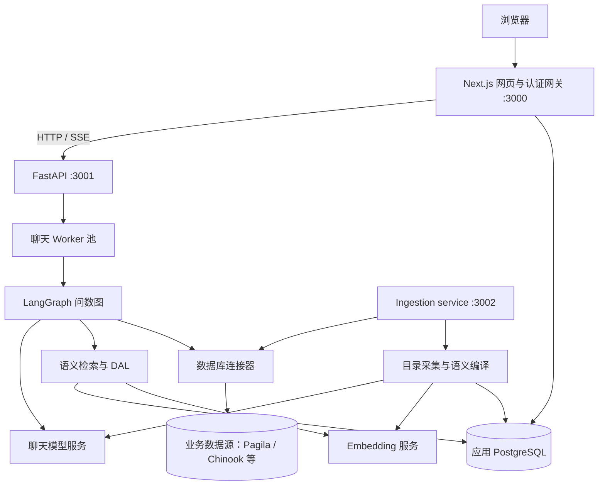
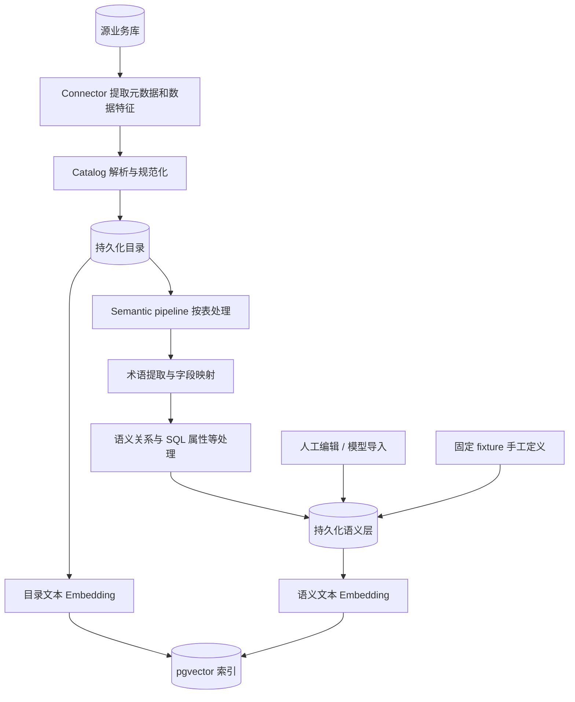
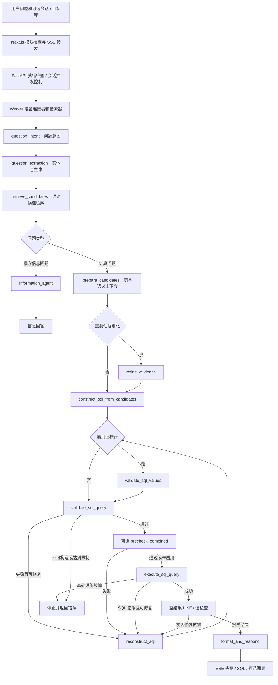
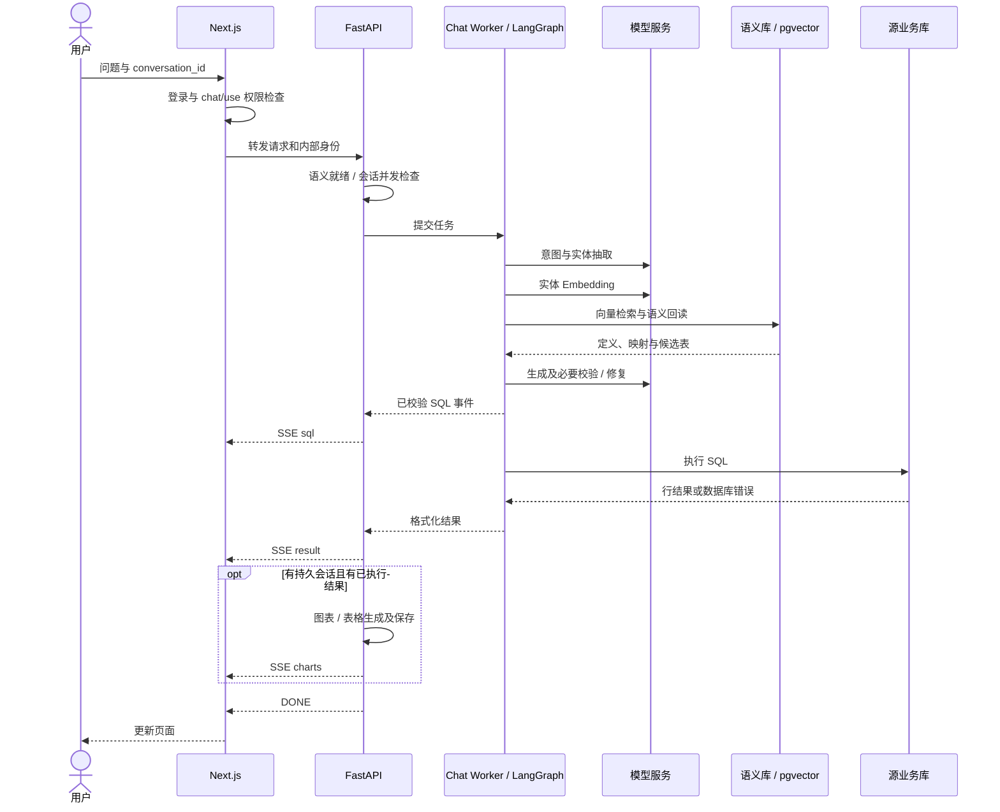
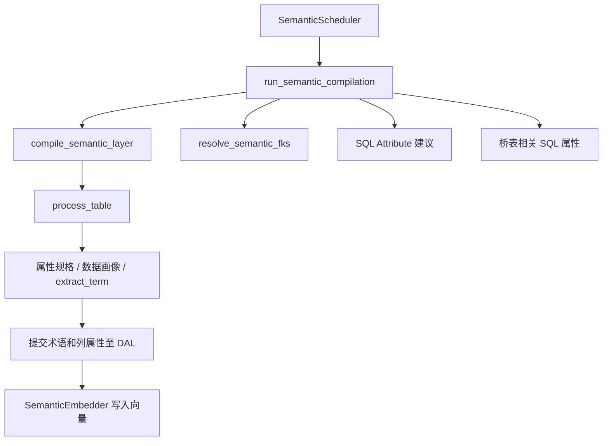

# 技术架构、本体作用与问数执行链路

本文依据当前工作区代码说明实现，配合[项目概览](./README.md)、[运行指南](./运行与数据初始化.md)和[Demo 指南](./Demo与模型导出.md)阅读。
图中省略部分状态字段、异常边和开关分支，以便理解；节点名称以代码为准。

## 1. 核心技术与各自解决的问题

| 技术 | 在本项目中的职责 | 主要代码 |
| --- | --- | --- |
| Next.js / React | 页面、会话、权限网关、聊天流转发 | `frontend/app/`、`frontend/auth/` |
| Better Auth / Prisma | 登录、会话与前端应用数据管理 | `frontend/auth/`、`frontend/prisma/` |
| FastAPI | 目录、语义、模型交换、聊天 API | `auto_ontology/server/` |
| LangGraph | 用显式状态与条件边组织问数、校验、修复循环 | `retrieval/text_to_sql/text_to_sql_graph.py` |
| LangChain / 模型客户端 | 聊天模型调用与结构化输出 | `utils/llm_invoke.py` |
| Embedding + pgvector | 对业务概念及目录文本做语义检索 | `utils/embedding.py`、`utils/retriever.py`、`vdb/` |
| PostgreSQL / SQLAlchemy Core | 保存目录、本体对象、关系及应用状态 | `dal/schema.py`、`dal/session.py` |
| SQLGlot | 多方言 SQL 解析及相关静态分析 | `catalog/sql_parse.py`、SQL 校验及模型交换模块 |
| 数据库连接器 | 抽取数据库元数据、执行 SQL、处理方言 | `connectors/` |
| SSE | 把进度、SQL、答案和图表逐步传给浏览器 | `server/chat/router.py`、前端聊天网关 |
| Alembic / Docker Compose | 数据库迁移与本地多服务部署 | `alembic/`、`docker-compose.yml` |

模型调用、向量相似度、确定性解析和源库执行承担不同任务。
向量相似度找的是“可能相关的定义”，不是数据库真实答案；最终金额等结果来自 SQL 执行。

## 2. 本体在这里起什么作用

本项目中的本体是业务概念及其与物理数据、计算定义、关系的组织方式。
它回答“这张表/这个字段在业务上代表什么”“某个指标怎样计算”“概念间如何关联”。
这是一套可操作的语义模型，并不意味着整个系统使用 OWL/RDF 推理机或每次进行形式逻辑证明。
当前目录及语义关系主要存放在 PostgreSQL 的关系表中；代码里的 graph 通常表示逻辑上的关系图，不要求独立 Neo4j 实例。

| 对象 | 作用 | 示例（解释性示例，不代表当前库一定有同名对象） |
| --- | --- | --- |
| Term | 业务概念，可代表一张或多张表 | 客户、电影、付款 |
| ColumnAttribute | 概念的属性，绑定到物理列 | 客户编号 → customer.customer_id |
| SQL Attribute | 派生表达式或计算定义，绑定概念与 SQL | 金额相关派生属性 |
| Semantic FK | 语义属性间的关联，辅助连接关系理解 | 某属性指向另一概念的属性 |
| CustomAnalysis | 可复用的分析 SQL | 按国家汇总付款金额 |
| Zone | 组织数据范围、支持相应的作用域处理 | 电影领域 |

本体有三个主要价值：

1. **业务词到物理对象的桥梁**：问题中的“国家”“收入”不必和字段英文名称完全相同。
2. **减少口径歧义**：把金额、时间、客户范围等定义固定为可检查的映射或 SQL。
3. **约束 SQL 上下文**：用检索出的概念、映射、候选表和关联路径组织提示词，而不是每次把所有表直接交给 LLM。

本体本身不保存完整业务事实，也不会自动保证生成 SQL 正确。
错误口径、过期映射或不准确的语义关系同样会让问数出错，需要人工审核和 SQL 结果验证。


例如 Pagila 的国家付款金额排名，可沿 `payment → customer → address → city → country` 关联。
“国家”取客户地址；若使用 Chinook 的账单国家，则是另一个物理映射和业务口径。
是否把“付款金额”称为“销售额”也需要业务确认，不能仅靠词向量决定。

## 3. 系统部署与数据流



当前应用库 `auto_ontology` 内：

- `public`：目录和语义层关系表，由 DAL 访问、Alembic 迁移管理。
- `frontend`：用户、会话等前端应用数据，由 Prisma 同步。
- `vdb`：`data_objects_layer` 与 `semantic_layer` 等向量集合。

`pagila` 是源业务数据库；`chinook.sqlite` 是另一个源文件。
导入目录和生成向量不等于将源库所有业务行复制到 `auto_ontology`。

## 4. 程序按什么组织

```text
frontend/
  app/api/                 Web 认证与权限网关
  app/settings/            连接与导入导出等页面
  auth/                    Better Auth 与权限
  prisma/                  前端 Schema 与迁移启动逻辑

auto_ontology/
  server/                  FastAPI API 与服务编排
    chat/                  聊天路由、Worker、会话与流式输出
    model_interchange/     模型 YAML 导入导出
  connectors/              PostgreSQL / SQLite 等源库适配
  catalog/                 目录提取、规范化、解析和写入
  semantic/                语义编译、术语提取、关系建议和向量化
  retrieval/
    text_to_sql/           LangGraph、Agent、状态、提示词及路由
    data_access/           语义检索、上下文和关联数据读取
    entity_coverage/       实体覆盖等相关能力
  dal/                     SQLAlchemy Core 数据访问和事务
  vdb/                     pgvector 集合读写与检索
  utils/                   模型调用、Embedding、检索和辅助工具
  ingestion_service/       导入、语义编译调度及 API

alembic/                   内部目录和语义表迁移
dev_tools/fixtures/        示例源库及手工语义模型
docs/openapi/              API 契约
mcp/                       只读 Agent 接入
```

API Router 处理协议与输入输出；Service 负责业务编排；DAL 负责持久化与事务。
Connector 访问业务库；VDB 访问向量集合。即使二者都在 PostgreSQL，也不承担同一职责。
不要把 API 路由、LLM Agent、本体对象和 LangGraph 节点混为一种“模块”。

## 5. 问数之前：目录与本体如何形成



自动编译入口见 `semantic/compile.py`、`semantic/pipeline.py`，按表处理见 `semantic/visit_enter.py`。
术语、语义关系与 SQL 属性相关实现分别见 `term_extractor.py`、`semantic_fk.py`、`sql_attribute_suggester.py`。
不是每张表都会产生相同数量或种类的语义对象；要检查实际运行状态和结果。

`seed_graph_fixture.py` 走手工、确定性测试路径，特意屏蔽 Embedding 副作用。
所以“有语义对象”与“有可检索的语义向量”是两个状态，这正是之前空候选错误的原因。
编译和导入可能向配置的模型服务发送元数据、样本或定义，应按实际数据和授权范围运行。

## 6. 从一句问话到 SQL：主链路流程图

下面是普通计算/分析问题的主链路。信息查询、预测及追问有额外分支。



失败路径有重建次数、图访问次数、超时等约束，不是无限循环。
`precheck_combined` 仅在相应 DB Probe 开关启用时加入，内部子检查也分别受开关控制。
不能把图中的“可选校验”描述成当前环境始终启用的保证。

## 7. 各阶段实际处理什么

| 节点 / 阶段 | 输入 → 输出 | 主要职责 |
| --- | --- | --- |
| Worker 初始化 | 配置 → 模型客户端、源库连接器、两类检索器 | 预热资源；连接失败会导致初始化失败 |
| question_intent | 问题 → 类型、意图和重写等状态 | 区分概念信息、计算和可选预测等 |
| question_extraction | 问题 → entities、subject 等 | 抽取“国家、销售额、月份日期”等实体 |
| retrieve_candidates | 实体向量 → Term / ColumnAttribute / SQL Attribute / CustomAnalysis 候选 | 找到业务上下文，保留数据库作用域 |
| prepare_candidates | 语义候选 → relevant_tables、属性和分析上下文 | 回读完整对象、准备 Schema 和关联路径，按相关性筛选 |
| refine_evidence | 已有上下文及证据 → 更精确证据 | 按状态选择性运行 |
| construct_sql_from_candidates | 问题、方言、Schema、语义定义 → SQL | 结构化模型输出；不能仅凭生成结果判定可执行 |
| validate_sql_values | SQL 和问题 → 值校验信息 | 可选值校验阶段 |
| validate_sql_query | SQL 和上下文 → valid / invalid 等决策 | SQLGlot 解析、静态分析与意图等校验 |
| precheck_combined | SQL → 探测结果与修复信号 | 可选字面值、Join 路径、JSONB 路径检查 |
| execute_sql_query | SQL、相关表、connectors → 数据结果或错误 | 根据表作用域选择连接器，在源业务库执行 |
| 空结果检查 | 空结果及 SQL → 接受或修复信号 | 区分可能的 LIKE / 字面值问题，空结果本身不必然是错误 |
| reconstruct_sql | 错误及已有上下文 → 修正 SQL | 回到校验，受限重试；网络故障不会靠改 SQL 解决 |
| format_and_respond | 结果及状态 → 答案 | 组织说明；聊天路由还可生成并持久化图表/表格气泡 |

入口状态使用 `AgentState`，包含问题、连接器、检索器、决策和 `path_state` 等。
`path_state` 携带候选、相关表、SQL、错误和结果；节点返回状态更新，由条件边决定后续节点。
这使中间结果可观察，也意味着前序检索为空会使后续节点缺少必要输入。

## 8. 请求时序与流式输出



`sql` 事件发生在执行前，不能把看到 SQL 当成执行完成。
`result` 和 `charts` 也有先后区别；前端采用流转发，避免代理缓冲使用户一直看不到进度。
无 `conversation_id` 的无状态请求不保存会话，也没有依赖会话持久化的图表步骤。
同一持久会话不允许两个同时运行的请求，可能返回 409。

## 9. SQL 在哪里执行，怎样避免混库

`SQLExecutionAgent` 使用 `resolve_connector_from_tables`，根据相关表选择目标连接器。
实际执行经连接器进入源库，而不是默认进入保存本体的 `auto_ontology`。
PostgreSQL connector 使用 psycopg 连接池；带超时参数的执行使用事务内的 `statement_timeout`。

语义候选中的 `database_name` 很关键：缺失作用域的候选可能被丢弃。
多库目录共存不意味着系统具有任意跨库 Join 引擎；应指定目标库并检查路由。
数据库执行权限由源库账号决定，源库应使用符合实际用途的权限；应用校验不能代替数据库权限边界。

## 10. 本次故障在架构中的位置

| 故障 | 所在环节 | 为什么影响后续 |
| --- | --- | --- |
| `.env` 未加载 | 工具入口 | 连接参数不存在，尚未进入目录处理 |
| 本机 5432 与 Docker 混淆 | Connector / 初始化 | 连接到错误实例或不存在的角色 |
| 容器内用 localhost | Worker 初始化 | 无法连接业务库，任务无法开始 |
| Azure Embedding 路径 404 | 候选检索 | 问题无法向量化，候选为零 |
| NVIDIA 参数发给 Azure Cohere | Embedding 适配 | 接口 400，无法生成有效向量 |
| 1536 与 2048 维不一致 | 向量存储 / 检索 | 向量列与模型输出不兼容 |
| 只有手工语义对象、没有向量 | 语义检索 | 本体存在，但从问题找不到相关对象 |
| prepare_candidates 校验失败 | LangGraph 节点输入 | 上游没有候选，不能准备有效 SQL 上下文 |

因此解决空候选要检查索引和作用域，不是直接删除校验或让 LLM 无依据猜 SQL。

## 11. 扩展代码时从哪里入手

- 新数据库：连接器接口、注册、方言、目录解析及执行能力；检查现有 `connectors/` 测试。
- 新模型服务：聊天客户端选择、结构化输出、Embedding 协议、认证、向量维度和超时；不要仅替换 Key。
- 新业务指标：先定口径，再维护 Term / SQL Attribute / CustomAnalysis，更新向量并验证查询。
- 新问数阶段：在 Agent、State 和 LangGraph 条件边中显式接入，覆盖成功与失败路径。
- 导入导出：修改 model_interchange 的 Schema、DAL 和转换逻辑，并检查往返、ID 引用及作用域。

调试时优先按“请求入口 → Worker → 图节点日志 → 模型响应 → 语义索引 → 源库结果”定位，避免同时改多个层。

## 12. 关键源码阅读顺序

1. [Web 聊天网关](../../frontend/app/api/chat/completions/route.ts)
2. [FastAPI 聊天入口](../../auto_ontology/server/chat/router.py)
3. [聊天 Worker](../../auto_ontology/server/chat/worker.py)
4. [流式运行与状态组织](../../auto_ontology/retrieval/text_to_sql/main.py)
5. [状态定义](../../auto_ontology/retrieval/text_to_sql/state.py)
6. [LangGraph 节点及条件边](../../auto_ontology/retrieval/text_to_sql/text_to_sql_graph.py)
7. [候选检索](../../auto_ontology/retrieval/text_to_sql/agents/candidates_retrieval.py)、[候选准备](../../auto_ontology/retrieval/text_to_sql/agents/candidates_preparation.py)
8. [SQL 构造](../../auto_ontology/retrieval/text_to_sql/agents/sql_from_semantic.py)、[SQL 校验](../../auto_ontology/retrieval/text_to_sql/agents/sql_parse_validation.py)、[SQL 执行](../../auto_ontology/retrieval/text_to_sql/agents/sql_execution.py)
9. [目录及语义数据 Schema](../../auto_ontology/dal/schema.py)、[向量存储](../../auto_ontology/vdb/postgres.py)
10. [语义编译 pipeline](../../auto_ontology/semantic/pipeline.py)、[语义 Embedding](../../auto_ontology/semantic/embed.py)

## 13. 哪些代码与本体构建及应用直接相关

阅读时可以分成四组：**构建本体 → 保存与维护 → 建立检索入口 → 在问数中使用**。
`semantic/` 是构建核心，但本体功能跨越 DAL、API、检索、界面和模型交换，不能只看一个目录。

### 13.1 本体构建：从物理数据库产生语义对象

| 代码入口 | 与本体的关系 | 建议关注 |
| --- | --- | --- |
| [catalog/](../../auto_ontology/catalog/) | 构建前置的物理目录，并非业务本体本身 | 表、字段、类型、主外键及目录规范化 |
| [connectors/](../../auto_ontology/connectors/) | 提供源库元数据与数据读取能力 | 物理事实从哪里来，使用哪个 SQL 方言 |
| [semantic/compile.py](../../auto_ontology/semantic/compile.py) | 自动语义编译总入口 `run_semantic_compilation` | 串联按表编译、语义 FK、SQL 属性建议与桥表处理 |
| [semantic/pipeline.py](../../auto_ontology/semantic/pipeline.py) | `compile_semantic_layer` 按表组织任务 | 并发提取、提交顺序、取消处理与表级编译 |
| [semantic/visit_enter.py](../../auto_ontology/semantic/visit_enter.py) | `process_table` 处理一张表并提交语义对象 | 数据特征采样、列画像、术语与属性持久化 |
| [semantic/term_extractor.py](../../auto_ontology/semantic/term_extractor.py) | `extract_term` 等提取、规范化业务术语 | LLM 输出、显示名、同义词和回退逻辑 |
| [semantic/deterministic.py](../../auto_ontology/semantic/deterministic.py) | 将物理列等信息组织成规则化属性规格 | 不依赖自由生成的名称、映射规则与描述增强；其中部分描述处理仍会调用模型 |
| [semantic/models.py](../../auto_ontology/semantic/models.py) | 定义编译过程使用的结构化对象 | 编译器内部数据契约，不等于数据库 Schema |
| [semantic/domain.py](../../auto_ontology/semantic/domain.py) | 读取领域上下文 | 业务背景怎样进入编译过程 |
| [semantic/prompts/](../../auto_ontology/semantic/prompts/) | 构建阶段的模型指令 | 术语和属性怎样被要求生成、遵循什么上下文 |
| [semantic/semantic_fk.py](../../auto_ontology/semantic/semantic_fk.py) | `resolve_semantic_fks` 解析语义 FK，选择 Join 默认项 | 语义关系怎样落到可使用的连接路径 |
| [semantic/fk_suggester.py](../../auto_ontology/semantic/fk_suggester.py) | FK 建议相关逻辑 | 关系候选和推断依据 |
| [semantic/sql_attribute_suggester.py](../../auto_ontology/semantic/sql_attribute_suggester.py) | 从查询历史建议 SQL 属性 | 派生定义的来源，不能把它解释为所有业务指标均自动发现 |
| [semantic/bridge_tables.py](../../auto_ontology/semantic/bridge_tables.py) | 桥表识别及相关 SQL 属性构建 | 多对多关系如何进入语义上下文 |
| [semantic/embed.py](../../auto_ontology/semantic/embed.py) | 将语义节点构造成文本并向量化 | 术语、属性、数据库作用域怎样进入检索索引 |
| [ingestion_service/semantic_scheduler.py](../../auto_ontology/ingestion_service/semantic_scheduler.py) | 调度语义编译 | 触发时机、目录采集依赖和任务状态 |
| [dev_tools/fixtures/seed_graph_fixture.py](../../dev_tools/fixtures/seed_graph_fixture.py) | 绕过自动提取，手工写入固定测试本体 | 当前 Demo 的术语、映射、语义关系和分析定义实际来源 |

自动构建的关键调用关系如下；下图表示主要编排，不代表每个分支始终执行或全部成功：



### 13.2 本体存储与维护：本体对象实际放在哪里

| 文件或模块 | 负责内容 |
| --- | --- |
| [dal/schema.py](../../auto_ontology/dal/schema.py) | 目录、本体实体及关系表的结构事实来源；从这里看 Term、ColumnAttribute 和关联表怎样组织 |
| [dal/terms.py](../../auto_ontology/dal/terms.py) | 术语、属性、语义编译相关读写，以及批量语义 Embedding 所需数据读取 |
| [dal/attributes.py](../../auto_ontology/dal/attributes.py) | 属性关系、关联路径等数据访问 |
| [dal/sql_attributes.py](../../auto_ontology/dal/sql_attributes.py) | SQL 属性及 SQL 与物理字段的关联读取/写入 |
| [dal/custom_analyses.py](../../auto_ontology/dal/custom_analyses.py) | 可复用分析定义 |
| [dal/exploration.py](../../auto_ontology/dal/exploration.py) | 关系图与探索所需查询 |
| [dal/zones.py](../../auto_ontology/dal/zones.py) | 区域对象与相应范围管理 |
| [dal/session.py](../../auto_ontology/dal/session.py) | 连接池和事务；本体更新是否保持一致性依赖这里的事务使用 |
| [server/terms/](../../auto_ontology/server/terms/) | 本体术语管理 API 与业务服务 |
| [server/sql_attributes/](../../auto_ontology/server/sql_attributes/) | 派生属性的校验、创建和维护 |
| [server/custom_analyses/](../../auto_ontology/server/custom_analyses/) | 分析定义管理及相关 Embedding |
| [server/exploration/](../../auto_ontology/server/exploration/) | 语义关系探索 API |
| [server/semantic_compilation/](../../auto_ontology/server/semantic_compilation/) | 编译状态和管理 API |
| [server/model_interchange/](../../auto_ontology/server/model_interchange/) 与 [dal/model_interchange.py](../../auto_ontology/dal/model_interchange.py) | 将本体及目录导出为 YAML，或导入并重建对象引用 |

`schema.py` 定义的是关系存储模型，`semantic/models.py` 定义编译过程对象，`model_interchange/schemas.py` 定义交换文件结构。
这三种“模型”解决不同问题；修改其中一种不能假定另外两种自动同步。

### 13.3 本体应用：问数时哪些代码真正使用本体

| 代码入口 | 用本体做什么 |
| --- | --- |
| [utils/retriever.py](../../auto_ontology/utils/retriever.py) | 将问题实体向量化，查询语义或数据目录集合 |
| [vdb/postgres.py](../../auto_ontology/vdb/postgres.py) | 向量记录存储与相似度检索；不是业务语义的定义来源 |
| [retrieval/data_access/semantic_search.py](../../auto_ontology/retrieval/data_access/semantic_search.py) | `search_semantic_index` 按标签和数据库等范围组织语义命中 |
| [retrieval/text_to_sql/agents/candidates_retrieval.py](../../auto_ontology/retrieval/text_to_sql/agents/candidates_retrieval.py) | 用实体查 Term、ColumnAttribute、SQL Attribute、自定义分析，形成候选 |
| [retrieval/data_access/candidates.py](../../auto_ontology/retrieval/data_access/candidates.py) | 获取和组织候选相关的上下文数据 |
| [retrieval/data_access/graph_schemas.py](../../auto_ontology/retrieval/data_access/graph_schemas.py) | 将相关目录对象组装为生成 SQL 所需 Schema 上下文 |
| [retrieval/text_to_sql/agents/candidates_preparation.py](../../auto_ontology/retrieval/text_to_sql/agents/candidates_preparation.py) | 根据语义命中反查物理表字段、准备路径、选择相关表与分析 |
| [retrieval/text_to_sql/formatters_util.py](../../auto_ontology/retrieval/text_to_sql/formatters_util.py) | 将语义定义和物理 Schema 格式化成模型上下文 |
| [retrieval/text_to_sql/agents/sql_from_semantic.py](../../auto_ontology/retrieval/text_to_sql/agents/sql_from_semantic.py) | 用问题、语义上下文及候选生成 SQL |
| [retrieval/text_to_sql/agents/sql_parse_validation.py](../../auto_ontology/retrieval/text_to_sql/agents/sql_parse_validation.py) | 用解析、已有上下文与意图等校验 SQL |
| [retrieval/text_to_sql/agents/sql_reconstruction.py](../../auto_ontology/retrieval/text_to_sql/agents/sql_reconstruction.py) | 结合语义上下文和失败依据修复 SQL |
| [retrieval/text_to_sql/agents/information_agent.py](../../auto_ontology/retrieval/text_to_sql/agents/information_agent.py) | 对概念和定义类问题组织信息回答，不必进入 SQL 执行路径 |
| [retrieval/entity_coverage/](../../auto_ontology/retrieval/entity_coverage/) | 对问题实体覆盖等进行处理，为澄清相关能力提供支持 |
| [mcp/auto_ontology_mcp/tools.py](../../mcp/auto_ontology_mcp/tools.py) | 将只读语义发现、目录和问数能力暴露给外部 Agent；以实际握手列表为准 |

`sql_execution.py` 是本体应用链路的后段：它执行经过上下文选择和校验的 SQL，但其职责不是构建本体。
同样，聊天 Router、Worker 和 SSE 主要承载运行与传输，本体语义决策集中在候选检索、准备、生成和校验相关模块。

### 13.4 前端哪些页面与本体有关

| 目录 | 用户看到的能力 |
| --- | --- |
| [frontend/app/terms/](../../frontend/app/terms/) | 术语及相关语义信息 |
| [frontend/app/exploration/](../../frontend/app/exploration/) | 图和关联探索 |
| [frontend/app/data/](../../frontend/app/data/) | 物理数据目录，与语义映射的基础 |
| [frontend/app/settings/import-export/](../../frontend/app/settings/import-export/) | 本体与目录模型导入导出 |
| [frontend/app/chat/](../../frontend/app/chat/) | 本体驱动的问数结果与交互 |
| [frontend/app/api/](../../frontend/app/api/) | 受认证、权限控制的操作入口 |

页面、前端 API 和后端服务的职责不同，页面显示出来不代表语义已完成编译或向量已就绪。

### 13.5 想研究本体，优先读哪几个文件

建议先走一条最短闭环，再扩展到调度、界面和模型交换：

1. **看存储结构**：`dal/schema.py`，理解实体与关系。
2. **看可读的实际例子**：`dev_tools/fixtures/seed_graph_fixture.py`，理解固定本体怎样写入。
3. **看自动生成**：`semantic/compile.py → pipeline.py → visit_enter.py → term_extractor.py`。
4. **看检索桥梁**：`semantic/embed.py → utils/retriever.py → data_access/semantic_search.py`。
5. **看应用闭环**：`candidates_retrieval.py → candidates_preparation.py → sql_from_semantic.py → sql_parse_validation.py → sql_execution.py`。
6. **看交换与迁移**：`server/model_interchange/service.py → dal/model_interchange.py`。

固定 fixture 的手工模型和自动编译结果最终进入相同的持久化及检索应用链路。
因此可以用 fixture 理解对象关系，但评估自动构建质量时必须单独运行并审查编译流程，不能用手工样本替代自动生成的评估。
